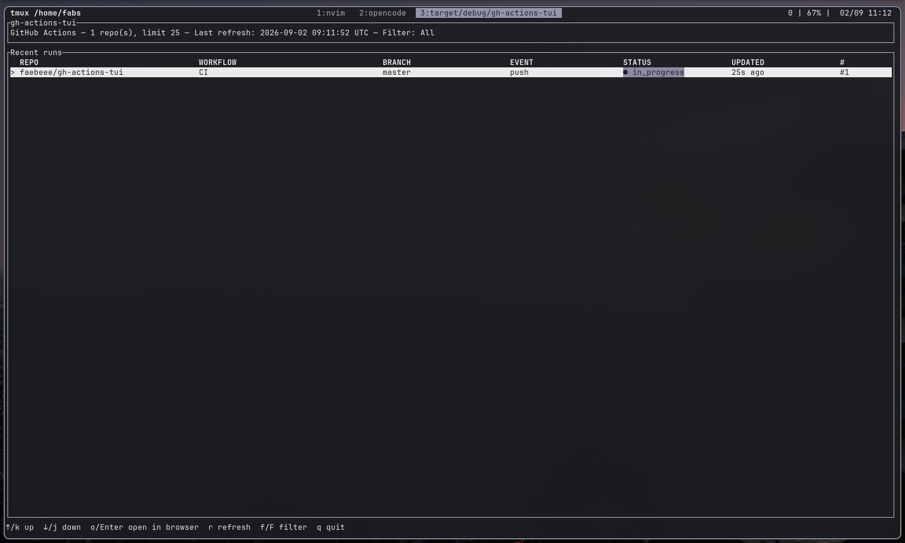

# gh-actions-tui

A terminal UI for watching GitHub Actions workflow runs across one or more
repositories, with auto-refresh, status filtering, and quick access to open
runs in your browser.



## Features

- Watch multiple repositories at once.
- Auto-refreshes on a configurable interval.
- Filter the runs table by status (All / Success / Failure / In Progress).
- Color-coded status indicators.
- Open the selected run in your browser with one keypress.
- Inline error reporting per-repo (a failure fetching one repo doesn't
  crash the whole app or hide the others).

## Requirements

- The [GitHub CLI](https://cli.github.com/) (`gh`), installed and
  authenticated (`gh auth login`). This app delegates authentication to
  `gh auth token`, so it inherits whatever account/scopes you're logged in
  with, including access to private repositories.

## Installation

Build from source with Cargo:

```sh
cargo build --release
```

The binary is produced at `target/release/gh-actions-tui`.

## Usage

```sh
gh-actions-tui <owner/repo> [<owner/repo> ...] [OPTIONS]
```

### Examples

Watch a single repository with default settings:

```sh
gh-actions-tui rust-lang/rust
```

Watch multiple repositories, fetching the 50 most recent runs per repo and
refreshing every 15 seconds:

```sh
gh-actions-tui rust-lang/rust octocat/Hello-World --limit 50 --interval 15
```

### Options

| Flag                 | Default | Description                                   |
| -------------------- | ------- | ---------------------------------------------- |
| `-l`, `--limit`      | `25`    | Number of most-recent runs to fetch per repo. |
| `-i`, `--interval`   | `30`    | Auto-refresh interval, in seconds.            |
| `-h`, `--help`       |         | Print help.                                   |
| `-V`, `--version`    |         | Print version.                                |

## Keybindings

| Key                  | Action                                  |
| -------------------- | ---------------------------------------- |
| `↑` / `k`            | Move selection up                        |
| `↓` / `j`            | Move selection down                      |
| `Enter` / `o`        | Open the selected run in your browser    |
| `r`                  | Refresh now                              |
| `f`                  | Cycle status filter forward              |
| `F` (Shift+f)        | Cycle status filter backward             |
| `q` / `Esc` / `Ctrl-C` | Quit                                    |

### Status filter

Pressing `f`/`F` cycles through:

```
All → Success → Failure → In Progress → (back to All)
```

The active filter is shown in the header (`Filter: <name>`). Rows that
represent a repo fetch error (rather than a run) are always shown,
regardless of the active filter, since they indicate a problem you likely
want to notice.

## Architecture

The codebase is organized as follows:

| Module         | Responsibility                                                                 |
| -------------- | ------------------------------------------------------------------------------- |
| `cli.rs`       | Command-line argument parsing and `owner/repo` validation.                    |
| `auth.rs`      | Retrieves a GitHub token by shelling out to `gh auth token`.                   |
| `github.rs`    | Thin wrapper around [`octocrab`](https://docs.rs/octocrab) for fetching runs.  |
| `status.rs`    | Classifies a run's raw `status`/`conclusion` strings into a `RunOutcome`.      |
| `app.rs`       | Application state: rows, status filter, selection, and their invariants.      |
| `event.rs`     | Input polling (background thread) and tick/fetch-result event bridging.       |
| `ui.rs`        | Renders the header, table, and footer with `ratatui`.                         |
| `main.rs`      | Terminal setup, the event loop, and key-handling dispatch.                     |

`status.rs` exists to give the status filter (`app.rs`) and the status
color/label (`ui.rs`) a single shared source of truth for what counts as a
success, failure, etc., so they can't silently drift apart as GitHub adds
new status/conclusion values.

`app.rs` caches the list of rows that pass the active filter (`visible`)
and recomputes it whenever the underlying rows or filter change, so
navigation, selection, and rendering all agree on the same snapshot rather
than each re-filtering independently.

## Development

Run tests:

```sh
cargo test
```

Run lints:

```sh
cargo clippy --all-targets
```
